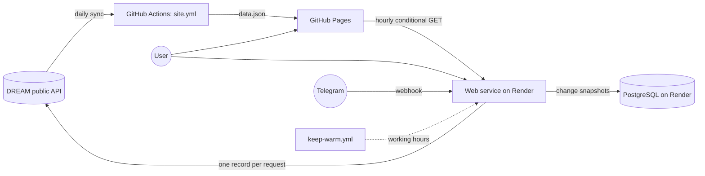

# dream-povnota

How complete the project records in the DREAM system are: which fields are filled in out of those that are relevant at a project's stage, and what is still missing. Broken down by stage, region, sector and organisation.

**Live page: [maksym-garkusha.github.io/dream-povnota](https://maksym-garkusha.github.io/dream-povnota/)** (in Ukrainian). The data is refreshed every day. The top of the page has a few key findings, each with a button that shows the records behind it; below are a tile map of the regions and the list of records, which can be filtered to one region and downloaded as CSV to pass on to communities.

**Web service: [dream-povnota.onrender.com](https://dream-povnota.onrender.com)** (in Ukrainian). It checks a single record right now, shows organisation and region pages with a change history, exports any selection to CSV or Excel and serves the same data through an API. It runs on a free plan and goes to sleep when nobody uses it, so the first request after a pause can take about a minute. See [Web service](#web-service).

**Telegram bot: [@dream_povnota_bot](https://t.me/dream_povnota_bot)** (in Ukrainian). Send it a DREAM project code or a record link and it replies with the relevant fields that are filled in and those that are missing.

[Українська версія](README.md)

This is an independent learning project built on DREAM open data. It is not affiliated with any government body, and its figures are not official statistics.

## Why

DREAM ([dream.gov.ua](https://dream.gov.ua)) is the system in which Ukrainian communities, regional administrations and regional restoration services manage reconstruction and public investment projects. Each project record is filled in by the project's initiator, and the level of detail varies a lot: some records have a cost estimate, funding sources, procurement and photos, while others have little more than a title.

The project answers a practical question for the people responsible for data quality in a community, a region or the system as a whole: **where exactly are records incomplete, and what is missing**. The program downloads every record through the public API, checks each one against the fields that are relevant at its stage, and publishes the result as a web page. An organisation can look itself up by name or EDRPOU code (the Ukrainian company registry number) and see a list of its records with what remains to be filled in for each.

This is not a ranking and not a compliance audit. The rules on which fields are mandatory at which stage are not published, so the wording here is deliberately neutral: a field is either "filled in" or "not filled in". Tables on the page are sorted by name by default.

## What the data shows

Snapshot of 17 November 2026: the API feed lists 16,172 projects. Of these, 14,610 are open; the remaining 1,562 are closed (cancelled as mistaken or duplicate, or not implemented) and are left out of everything below.

**Overall completeness.** Average completeness is 92.6%. 8,949 of the 14,610 records (61%) have everything filled in that is relevant at their stage. The description, location, documents and cost estimate are filled in in 99% of the records where these fields are relevant.

Most of the empty fields are at the implementation stage.

**Updates of records at the implementation stage.** At the implementation stage, 5,660 projects have either a funding source or a procurement process recorded. 1,398 of them, roughly one in four, were updated in the past year. The other 4,262 were last changed more than a year ago.

**Procurement without a funding source.** 4,678 projects have a procurement or contract recorded. In 1,335 of them no funding source is given.

**Committed funding without procurement.** Of 2,107 projects with committed funding, 411 have no procurement or contract recorded.

**Sector.** 1,384 open records, roughly one in ten, have no sector classification. These projects are not included in breakdowns by sector.

**English fields.** 208 of the 14,610 projects (1.4%) have an English title. Among the 2,963 approved projects that have neither funding nor procurement yet (marked on the page as looking for funding), 54 have an English title.

Smaller findings:

- in 60 open records the description is a placeholder word: `NULL`, a hyphen or a full stop;
- all 5,934 distinct EDRPOU codes in the records pass the check-digit test;
- in 17 open records the EDRPOU field holds a ten-digit number, i.e. the tax number of a sole proprietor rather than a company code. The program does not store these numbers;
- the feed contains no project created after November 2025 (going by the date in the project code), although existing records are still being updated. The page therefore covers projects registered between September 2023 and November 2025. Whether newer projects are managed in another module cannot be seen from the open data.

The full report with all breakdowns: [report.md](https://maksym-garkusha.github.io/dream-povnota/report.md), regenerated daily along with the page.

## How it is calculated

### Stages

The stage comes from the record's `internal.status`:

| Status in the API | Stage |
|---|---|
| `pending:initiated` | Idea |
| `pending:defined` | Defined |
| `pending:appraised` | Appraised |
| `active:*` | Implementation |
| `complete*` | Completed |
| `cancelled*`, `unsuccessful*` | Closed: cancelled, mistaken, duplicate, not implemented |
| anything else | Unknown status |

Closed records and records with an unknown status are excluded from the checks and breakdowns; they are only counted.

### Checks

Each check applies only where the field is relevant. The list lives in a single file, [CheckList.cs](src/DreamPovnota.Core/Checks/CheckList.cs).

| Check | Relevant | Filled in if |
|---|---|---|
| Description | all open | the Ukrainian description, with HTML removed, is not empty, not a placeholder and at least 30 characters long |
| Location (KATOTTG code) | all open | there is at least one KATOTTG code in the project or, if there is none, in its linked objects |
| Sector | all open | there is a `WB-ECO` classification (World Bank sectors) |
| Documents or photos | all open | there is at least one document in the project, its `approaches` or its linked objects |
| Duration | from Defined | `period.durationInMonth` is greater than zero |
| Purpose | from Defined | the Ukrainian `purposeDetails` is not empty and not a placeholder |
| Cost estimate | from Appraised | the sum of non-cancelled `budgetBreakdown` lines is greater than zero |
| Funding source | Implementation and Completed, if there is a non-cancelled procurement or contract | the sum of non-cancelled funding sources is greater than zero |
| Procurement or contract | Implementation and Completed, if there is `committed` funding | there is at least one non-cancelled contracting process |
| Updated in the past year | Implementation only, if there is funding or procurement | no more than 365 full days between the last change and the snapshot date |
| English title | all open | the `en` title is not empty |
| English description | all open | the `en` description, with HTML removed, is not empty and not a placeholder |

Placeholders are `NULL`, `-`, `.`, `N/A`, `НЕМАЄ` and `НЕМА` ("none" in Ukrainian), case-insensitive, as well as text that is empty once tags are removed.

**Why the three implementation checks are conditional.** The status `active:approved` means the project has been approved, not that money is available. An approved project with no funding and no procurement is in a normal state: it is looking for funding, and its empty fields are not a gap. So at the implementation stage the checks look for consistency: procurement is recorded but no funding source; funding is committed but there is no procurement; money or contracts are moving but the record has not been touched for a year. Approved projects with neither funding nor procurement are flagged separately as looking for funding, and the page has a filter for them.

**Record completeness** is the share of relevant checks that are filled in, not counting the English fields. The average completeness of a group is the mean of these shares across its records.

**Why the English fields are kept separate.** About 1.4% of records have an English title, so including the English fields would lower the score of almost every record and hide the other differences. They still matter for projects that are seeking money from foreign donors, so they are shown as a separate group, with a separate count for projects looking for funding.

**Region** is taken from the KATOTTG codes (the Ukrainian classifier of administrative units): the two digits after `UA`. If a project's codes belong to different regions it is shown under "Several regions"; if there are no codes, under "Not specified". **Organisation** is the party with the `projectAuthor` role or, if there is none, the first `initiator`; this is the party that maintains the record. **Sector** is the first letter of the `WB-ECO` code; codes whose letter is not in the World Bank list (`O`, `OB` and `OC` occur) are shown as "Other sector code", since the field is filled in.

### What the method does not see

- It checks whether a field is filled in, not whether it is correct. A 30-character description that explains nothing counts as filled in, and cost estimates are not reconciled with contracts.
- It is not known which fields DREAM treats as mandatory at each stage. The checks reflect what a reader would reasonably expect from a record, not an official regulation.
- The program sees only what the public API returns. If some projects are managed in another module (see the last point under "What the data shows"), they are not included here.
- Sole proprietors who maintain records are deliberately not told apart: their codes and names are not stored, so on the page they are grouped together.

## What would help in the system itself

These points are not about the people who maintain the records but about where the system could prompt them. None of them requires changing the data model.

1. **A reminder about stale records.** If a project has an active contract and the record has not been changed for six months, the person responsible gets a reminder to update its status. This covers the largest group of empty fields among those that count towards the score: 4,262 records at the implementation stage.
2. **A consistency prompt on save.** When someone records a procurement for a project without a funding source, the system asks for one. It would be a prompt, not a block, shown while the person is still in the form.
3. **Sector as a required field** at the very first step. It is currently missing in one record in ten.
4. **An automatic draft of the English title.** The project title can be machine-translated and offered to the initiator for one-click confirmation. For projects looking for funding, this is the cheapest way to become visible to donors.
5. **Not accepting placeholder words instead of text.** `NULL`, a dash or a full stop in the description field is an empty field, and the form can say so.
6. **New projects in the open API.** If projects created after November 2025 are indeed managed in another module, it would help to publish them through the same public interface, so that the open data does not stop in 2025.

## Running it

You need the [.NET 11 SDK](https://dotnet.microsoft.com/download/dotnet/11.0). .NET 11 is a Standard Term Support (STS) release, but under Microsoft's current policy its support ends on 14 November 2028, the same day as .NET 10 LTS. The console program needs no database; running the web service is described under [Web service](#web-service).

```bash
git clone https://github.com/maksym-garkusha/dream-povnota.git
cd dream-povnota/src/DreamPovnota

dotnet run -- sync --cache ../../data         # download records from the API into the cache
dotnet run -- export --cache ../../data ../../site   # build site/data.json
dotnet run -- report --cache ../../data ../../docs/report.md
dotnet test                                   # from the repository root
```

The page is a plain HTML file, but it loads `data.json` with `fetch`, so it has to be served over HTTP: `python3 -m http.server` in the `site` folder is enough.

The API is a public government service, so the client takes it slowly: 2 parallel requests by default and a 100 ms pause before each request; at the speed the API answers, that is about 10 requests per second instead of 36 with 4 parallel requests and no pause. The first `sync` downloads every record (16,172 projects and 14,199 objects) and takes about an hour. The daily run fetches only the records that changed since the previous run. A full pass is needed only the first time or after the parsing changes. Other options:

- `--limit 300` takes only the first 300 projects in the feed, for a quick test;
- `--parallel 2` sets how many records are downloaded at once;
- `--as-of 2026-11-17T22:00:00Z` sets the snapshot date for `export` and `report` (now by default). "Updated in the past year" is measured from it, so the same cache and the same date always give the same figures.

If download errors exceed 2% of the feed, `sync` exits with a non-zero code so that the workflow does not publish incomplete data. The same happens if the feed suddenly lists 10% fewer projects than the cache (and at least a hundred fewer); the cache is then left as it was.

## How it works

```
src/DreamPovnota.Core/   shared by the console program and the web service
  Dream/     API client: paged feeds, records, retries
  Cards/     parsing JSON into project and object records, HTML cleanup, stages
  Store/     cache of parsed records in JSON Lines
  Sync/      feed, comparison with the cache, downloading what changed
  Checks/    the checks and per-record evaluation
  Geo/       regions from KATOTTG codes
  Codes/     EDRPOU check digit
  Stats/     breakdowns by stage, region, sector and organisation
  Export/    data.json for the page, and reading it back
  Digest/    digest for the restoration services: xlsx, PDF, the font and its licence
src/DreamPovnota/        console program: sync, export, report, digest
  Report/    Markdown report and digest files
src/DreamPovnota.Web/    web service (ASP.NET Core, Razor Pages and minimal APIs)
  Import/    loading data.json from Pages, retries after a failure
  Live/      checking a single record in DREAM
  History/   snapshots in PostgreSQL, migrations, form keys
  Lists/     record filter, CSV and Excel
  Api/       /api/v1
  Feeds/     Atom feeds
  Pages/     pages
site/        the page: a single HTML file, no build step
docs/        the report the figures in this README come from; the link preview template
tests/       xUnit; fixtures are real API responses with personal names replaced
```

**A database only for history.** There are about 15,000 open records; they fit in memory, and the console program's output is two static files. It reads the cache, computes everything in two to three seconds and writes `data.json` and the report without a database. The web service also keeps the current edition in memory and needs PostgreSQL only for the change history.

**The cache holds parsed records, not raw responses.** A raw project record is 30 to 300 KB; a parsed one is about 1.5 KB, so the cache for the whole snapshot takes 26 MB. Raw responses also contain people's names, while parsed records do not, so the cache can safely be kept between workflow runs. The trade-off: when parsing changes, the old cache is no longer valid. In Actions the cache key depends on the code in `Cards/`, so after such a change every record is downloaded again; locally, the cache folder has to be deleted by hand.

**Personal data.** The API returns the names of managers (`parties[].persons`) and lists sole proprietors as parties with the `UA-IPN` scheme, where the code is a personal tax number and the name is a person's name. The parser does not read `persons` at all, and for a sole proprietor it keeps only the role and a flag saying it is a sole proprietor. The same applies to a ten-digit number recorded under the `UA-EDR` scheme and to a party whose name contains "ФОП" or "фізична особа" (sole proprietor). The scheme is compared regardless of case, and spaces and hyphens are removed from the code before it is checked, so `ua-ipn` or `123 456 7899` do not slip past the filter. Tests make sure that the test numbers and fictitious names from the fixtures do not appear in the cache, `data.json` or the report.

**A page without a server.** Every day GitHub Actions restores the cache from the previous run, downloads the changed records, builds `data.json` (4.8 MB, about 0.9 MB compressed) and the report, and publishes them with the page on GitHub Pages. Search and filters run in the browser: 15,000 rows are filtered in a few milliseconds, and only the first 50 are drawn. The filter state is kept in the page address, so a selection can be shared as a link.

**The `data.json` format.** To keep the file small, projects are stored as arrays, and organisations, regions, stages and sectors are kept in lookup lists that projects refer to by index. A project row is `[code without "DREAM-UA-", title, organisation, region, stage, sector, last change date, relevant checks, filled checks, looking for funding]`. Checks are stored as bit masks in the order of the `checks` array. Titles are cut to 160 characters.

## Web service

**[dream-povnota.onrender.com](https://dream-povnota.onrender.com)** adds what the static page cannot do without a server:

- checking a single record at the moment of the request: paste a DREAM project code or record link, and the service fetches it from the API and evaluates the same fields as the page;
- organisation and region pages listing the fields that are missing, with links to the records that lack each field;
- a change history from snapshot to snapshot, with Atom feeds per organisation and region;
- changes by week: how many records were updated, how many fields filled in, how many records appeared and moved to another stage, with a separate total for the restoration agency and services (see [Changes by week](#changes-by-week));
- CSV and Excel export of any selection;
- an open API described with OpenAPI;
- the Telegram bot [@dream_povnota_bot](https://t.me/dream_povnota_bot) with the same record check (see [Telegram bot](#telegram-bot)).

It is the same independent learning project built on open data: it is not affiliated with any government body, and its figures are not official statistics.

### Architecture



Only GitHub Actions walks the whole DREAM feed, and it has no access to the database. The service fetches the published `data.json` from Pages at start-up and then hourly with `If-None-Match`, so an unchanged file costs one 304 response. If a fetch fails, it tries again after 10 s, 30 s, 1, 2 and 5 minutes, then every 10 minutes. The current state is kept in memory, so pages and the API never wait for the database; only the history goes to PostgreSQL.

**History.** Every new `data.json` edition becomes a snapshot. A new version of a record is written only when its organisation, region, stage, sector, update date, filled fields or the looking-for-funding flag changed. Each version stores the span of snapshots in which it is valid as a PostgreSQL range, and a temporal primary key (`WITHOUT OVERLAPS`) in PostgreSQL 18 keeps the versions of one record from overlapping. In a local test the first snapshot took about 9 MB; after that only changes are added. The history starts with the service's first snapshot in November 2026: DREAM does not expose earlier changes. `data.json` holds only open records, so a record that leaves the list is shown as "no longer among the open records (closed or removed from DREAM)". When the database is unavailable, pages show the current state with a notice, and history API responses return 503.

**Live check.** Only the project code is taken from the form input; the service builds the DREAM request address itself, so user input never becomes a URL. Links are accepted only for `dream.gov.ua`. Records with more than 30 linked objects are not checked live. A result is kept for 10 minutes. Only pressing the form button calls DREAM, not opening a page, so search engine crawlers cause no outgoing requests. One IP address can run 6 checks a minute and 30 an hour. The whole service allows 120 an hour, and only checks that actually reach DREAM count towards it: a form without a valid token, a malformed code or a cached result does not.

### Running it locally

Without a database, using the `data.json` published on Pages:

```bash
cd src/DreamPovnota.Web
dotnet run        # http://localhost:5080, history is off
```

To use your own file built with `export`, pass its path: `DATA_URL=../../site/data.json dotnet run`.

With a database, through Docker Compose (PostgreSQL 18 and the service, `data.json` from Pages):

```bash
docker compose up --build   # http://localhost:10000
```

The history tests use a real PostgreSQL and create a temporary database each. Without the `TEST_DATABASE_URL` variable they are skipped; in CI they run against a `postgres:18` service container.

```bash
TEST_DATABASE_URL=postgres://user@localhost:5432/postgres dotnet test
```

### API

GET only, JSON responses, errors as Problem Details. Description: [/openapi/v1.json](https://dream-povnota.onrender.com/openapi/v1.json).

```bash
# Chernihiv region records without a cost estimate, first 5
curl 'https://dream-povnota.onrender.com/api/v1/cards?region=74&missing=cost&pageSize=5'

# find an organisation by part of its name
curl -G 'https://dream-povnota.onrender.com/api/v1/orgs' --data-urlencode 'q=Ірпінська'

# region completeness by snapshot, and changes in the latest snapshot
curl 'https://dream-povnota.onrender.com/api/v1/regions/74/trend'
curl 'https://dream-povnota.onrender.com/api/v1/changes?region=74'
```

| Path | Returns |
|---|---|
| `/api/v1/meta` | data edition with the file's SHA-256, checks, regions, stages, sectors |
| `/api/v1/cards` | records with a filter: `q`, `region`, `org`, `stage`, `sector`, `missing`, `seeks=1`, `page`, `pageSize` up to 500 |
| `/api/v1/cards/{code}`, `/api/v1/cards/{code}/history` | one record; the same with its versions in the history |
| `/api/v1/cards.csv`, `/api/v1/cards.xlsx` | the same selection as a file, all rows |
| `/api/v1/orgs`, `/api/v1/orgs/{key}`, `/api/v1/orgs/{key}/trend` | organisation search, one organisation, completeness by snapshot |
| `/api/v1/regions`, `/api/v1/regions/{key}`, `/api/v1/regions/{key}/trend` | the same for regions |
| `/api/v1/snapshots`, `/api/v1/changes` | snapshots, and record changes in a snapshot (`snapshot`, `org`, `region`) |
| `/api/v1/changes/summary` | changes by week and by day for the first week, the same figures as on `/changes` |

A record code is written without `DREAM-UA-`. An organisation key is its EDRPOU code, or `n:` and the name for an organisation without one. A region key is the two KATOTTG digits (`74`), `multi` or `none`. One IP address can make 120 requests and 10 file exports a minute.

### Excel and Power BI

The CSV is written so that Excel with Ukrainian regional settings opens it with a double click: UTF-8 with a byte order mark, semicolons, whole numbers, dates as `2026-11-17`. A cell that starts with `=`, `+`, `-` or `@` gets a leading apostrophe so that Excel does not run it as a formula. Excel turns EDRPOU codes with a leading zero into numbers when it opens a CSV; in the xlsx file they stay text.

The full file without a filter is prepared once per edition and served with `ETag` and `Last-Modified`, so downloading an unchanged file again costs a 304 response, and an interrupted download can be resumed. Filtered exports are built on request and cached until the next edition. `page` and `pageSize` do not affect a file: it always holds every row of the selection.

**Excel.** Data → From Web, address `https://dream-povnota.onrender.com/api/v1/cards.csv?region=74`. In Power Query choose the "Semicolon" delimiter and the "65001: Unicode (UTF-8)" file origin. Or download the ready file: `https://dream-povnota.onrender.com/export/cards.xlsx?region=74`.

**Power BI.** Get data → Web, or an M query:

```
let
    Source = Csv.Document(
        Web.Contents(
            "https://dream-povnota.onrender.com/api/v1/cards.csv",
            [Query = [region = "74"], Timeout = #duration(0, 0, 2, 0)]),
        [Delimiter = ";", Encoding = 65001, QuoteStyle = QuoteStyle.Csv]),
    Cards = Table.PromoteHeaders(Source, [PromoteAllScalars = true])
in
    Cards
```

The base address stays fixed and the filter goes into `Query`, so scheduled refresh in the Power BI Service works with anonymous access. The two-minute timeout covers the service waking up.

### Telegram bot

[@dream_povnota_bot](https://t.me/dream_povnota_bot) runs the same check as the `/check` form: send it a project code or a record link and it replies in plain text, in Ukrainian. The bot only answers in private chats.

The reply to `DREAM-UA-190424-A10FC799`:

```
Капітальний ремонт та модернізація харчоблоку Авдіївського ліцею в с. Авдіївка Чернігівської області.
DREAM-UA-190424-A10FC799
Стадія: Реалізація
Організація: ПОНОРНИЦЬКА СЕЛИЩНА РАДА
Заповнено 10 з 10 доречних полів.

Заповнено:
• Опис проєкту
• Місце (код КАТОТТГ)
• Сектор
• Документи або фото
• Тривалість
• Мета
• Кошторисна вартість
• Джерело фінансування
• Закупівля або договір
• Оновлювалась за останній рік

Англійською, поза підрахунком:
• є: Назва англійською
• є: Опис англійською

Усе, що доречне на цій стадії, заповнено.

Картка в DREAM: https://dream.gov.ua/ua/project/DREAM-UA-190424-A10FC799/profile
Усі картки організації: https://dream-povnota.onrender.com/org/04412567
Перевірено 18.11.2026, 08:31 за Києвом.
```

When something is missing, a «Не заповнено» (not filled in) list appears, and the line saying that everything relevant is filled in is replaced by «Дописати першим» (add first): the first missing field and why it matters. The English title and description are listed apart, because they do not count towards completeness, as on the page. The organisation link is there when the service has a page for it. `/start` and `/help` explain what the bot does, `/check <code>` works too, and a message without a code gets an example of the format.

**How it works.** Telegram sends every message as a POST to `/telegram/webhook` and puts the secret in the `X-Telegram-Bot-Api-Secret-Token` header. The secret is only in the header, not in the address, because addresses end up in proxy logs. The service compares the header with the webhook secret in constant time, and a request without it or with a different value gets 401. A genuine update is answered with 200 straight away and the record is checked in the background from a queue of 20 messages, so Telegram does not wait for DREAM and does not send the same update again. The code is taken from the text by the same parser the form uses, and the service builds the request to DREAM itself. The service-wide limit of 120 live checks an hour is shared by the form and the bot and, as before, is spent only on a real request to DREAM. The bot answers one chat at most 6 times a minute and 30 times an hour, and says so once every 10 minutes when the limit is reached. This limit is checked before the queue, so one chat sending a burst of messages cannot take the places of others. `/telegram` accepts up to 300 requests a minute from one IP address: updates come from a few Telegram addresses, and the usual page limit would stop all users at once. Replies are sent without `parse_mode`, so a record title from DREAM cannot turn into markup.

**What the bot does not keep.** The message text and chat id stay in memory while the reply is prepared and are not written anywhere, neither to the database nor to the log. The log only gets the type of a failure, such as «Telegram відповів 403» (Telegram answered 403). Per-chat limits are counted in memory, keyed not by the chat id but by its HMAC fingerprint under a random key that disappears when the service restarts. Telegram itself sees the messages, as with any bot.

**Switching the bot on in your own deployment.** On `dream-povnota.onrender.com` the bot is already running; this is for anyone who deploys the service themselves. Without the `TELEGRAM_BOT_TOKEN` variable the bot is off and the service has no webhook address at all.

1. In Telegram, open [BotFather](https://t.me/BotFather), send `/newbot` and choose the bot's name and username. BotFather gives you a token.
2. In Render: the service, Environment, add `TELEGRAM_BOT_TOKEN` with that token and save. The bot starts working after the deploy.

The service does the rest. It derives the webhook secret from the token (HMAC-SHA256 with the token as the key, 64 hex characters), so no separate variable is needed: anyone who knows the token can reconfigure the bot anyway. After start the service calls `setWebhook` with `{public address}/telegram/webhook`, that secret and `allowed_updates=["message"]`. Render passes the public address itself in `RENDER_EXTERNAL_URL`; outside Render, `TELEGRAM_WEBHOOK_URL` sets it. If Telegram does not answer or answers 429 or 5xx, the service tries again after 5 s, 30 s, 2 and 5 minutes; on any other 4xx, such as a wrong token, it does not retry. The log shows «Вебхук Telegram зареєстровано» (webhook registered) or the reason as a status code, without the token. A secret of your own can replace the derived one through `TELEGRAM_WEBHOOK_SECRET`: 16 to 256 characters from `A-Z`, `a-z`, `0-9`, `_` and `-`, for example `openssl rand -hex 32`.

If the service could not register the webhook itself, it can be done by hand. `read -rs` asks for the token without echoing it, so it does not stay in the shell history, and the secret is computed from the token the same way the service does it:

```bash
read -rs TOKEN    # paste the token from BotFather, Enter
SECRET=$(printf %s 'dream-povnota/telegram-webhook' | openssl dgst -sha256 -hmac "$TOKEN" -r | cut -d' ' -f1)
curl -sS "https://api.telegram.org/bot$TOKEN/setWebhook" \
  --data-urlencode "url=https://dream-povnota.onrender.com/telegram/webhook" \
  --data-urlencode "secret_token=$SECRET" \
  --data-urlencode 'allowed_updates=["message"]'
```

If Render has its own `TELEGRAM_WEBHOOK_SECRET`, use `read -rs SECRET` instead of the second line. `curl -sS "https://api.telegram.org/bot$TOKEN/getWebhookInfo"` in the same shell shows the webhook state: `pending_update_count` is the queue on Telegram's side and `last_error_message` the latest delivery error, if there was one. Links in replies point to `https://dream-povnota.onrender.com`; the `PUBLIC_URL` variable sets a different address. While the free instance is asleep, the first message waits about a minute for the service to wake up.

### Changes by week

The [`/changes`](https://dream-povnota.onrender.com/changes) page counts, from the service's own history, what changed in the open records each week: in how many records the update date in DREAM changed, how many fields were filled in and which ones, how many records appeared and how many moved to another stage. The same figures are given as one total for the restoration agency and services from the digest list, without comparing the services with each other, plus up to three examples of where the most fields were filled in that week. The first week of the history is also shown day by day. DREAM does not publish a change history, so these figures exist only from the point the service started collecting them, 18 November 2026.

Weeks are ISO weeks, from Monday, in Kyiv time. Each period is compared as a whole: the records in the last snapshot before it starts against the last snapshot inside it. A record changed twice in one week therefore counts once, and the days need not add up to the week. A field counts as filled in if it was relevant at the record's stage and empty at the start and filled in at the end; the bit masks of the two snapshots are matched by check code, since the list of checks may have changed. "Updated within the last year" is not counted as a field here, as it follows from the update date. At most the last 12 weeks are shown.

The SVG charts are drawn by the server, with no scripts and no inline styles, so the CSP stays as strict as before. Each group of charts is followed by a table with the same figures. `/api/v1/changes/summary` returns these totals, and the [`/changes.atom`](https://dream-povnota.onrender.com/changes.atom) feed has one entry per week; the entry for the current week is updated with every snapshot. `/api/v1/changes` was already taken by record changes in a single snapshot (the history backup reads it), so the summary sits next to it.

### Digest for the restoration services

A weekly digest for the State Agency for Restoration and Infrastructure Development of Ukraine and 21 regional restoration and infrastructure development services. The list is fixed by EDRPOU codes in `DigestOrganisations`: every organisation in the `data.json` of 18 November 2026 whose name contains "агентство відновлення" or "служба відновлення". On that date no service in the Volyn, Donetsk or Luhansk regions maintains open records. If a new service appears in the data, the `digest` command reports it; adding it to the list is a manual step.

Each organisation gets two files:

- an xlsx workbook with the sheets "Зріз" (summary), "Картки" (stage, fields not filled, what to add first, link to the DREAM record) and "Що змінилось за тиждень" (which records were updated and which fields were filled in during the week);
- a one-page A4 PDF: open records, how many have every applicable field filled, how many were updated during the week, up to five fields that are easiest to add, and a link to the organisation page. The footer gives the edition date and the first 16 characters of the SHA-256 of the `data.json` the file was built from; the "Зріз" sheet of the xlsx has them too.

The week is the seven days up to and including the edition date. "Updated this week" uses the record's update date in DREAM. Newly filled fields come from the history in the service database: the state of the records at the start of the week is compared with the current edition, by check code rather than by bit. History starts on 18 November 2026, and until it covers a full week the files say so. "What to add first" follows the order in `DigestEase`: fields picked from a list or written in one line come first (sector, English title, duration), then texts, files and the cost estimate. As on the pages, English fields do not count towards "every applicable field filled", so for a record they come first only once everything else is filled.

The service has `/digest` (a fixed order: the agency, then the services by region name) and `/digest/{EDRPOU}` with the same figures and xlsx and PDF buttons. Pages and files are excluded from search engines (`noindex`, `X-Robots-Tag`), the files share the export rate limit, and they are built once per data edition.

The same without the service:

```bash
dotnet run -- digest --edition ../../site/data.json --history https://dream-povnota.onrender.com ../../digest
```

`--history` points to where the start-of-week state comes from (`/api/v1/digest/baseline`). Without it, or if the service does not answer, the digest is built without newly filled fields and the files say so. Every Monday the `digest.yml` workflow does the same: the files stay as a workflow artifact for 30 days and are not published on Pages. Before building, it compares the SHA-256 of `data.json` on Pages with `/api/v1/meta` and builds nothing if they differ (see [Data integrity](#data-integrity)).

The PDF is written with PdfPig 0.1.16 and the xlsx with MiniExcel 1.47.1, both under the Apache 2.0 licence. The PDF embeds IBM Plex Sans 3.004; its SIL Open Font License 1.1 sits next to the font in `src/DreamPovnota.Core/Digest/Fonts/OFL.txt`. The author property of the files is "Максим Гаркуша"; Creator and Producer carry the project name.

### Data integrity

The service does not accept a new `data.json` in which far more changed at once than in a usual day. A tampered or broken file on Pages therefore reaches neither the pages, nor the history, nor the digest for the restoration services. A new edition is compared with the current one, and after a restart, when nothing is in memory yet, with the latest snapshot in the database. The edition is rejected if:

- the number of open records changed by more than 5%;
- the number of organisations with open records changed by more than 5%;
- more than 20% of records changed: new ones, removed ones, and those whose applicable or filled fields differ. Fields are compared by check code, so a new check on its own does not mark records as changed.

The previous edition then stays current. `/health/ready` shows the type of the reason in `lastError` (`EditionGuard: open-cards`, `EditionGuard: organisations` or `EditionGuard: changed-cards`), and the figures go to the log at Warning level. The reason stays until the next edition is accepted.

Where the limits come from. The `data.json` of 18 November 2026 has 14,610 open records and 2,834 organisations. Over the last 12 months the busiest day saw 116 records (0.8%) last updated on 25 March 2026; no other day had more than 33 (0.2%). The update date in `data.json` is the latest one, so these are lower bounds. By the date in the project code, the most records created in one day was 355 on 11 September 2023, 2.4% of today's open records. Only two weeks went above 5%: 1,051 records (7.2%) on 19 to 25 August 2024 and 743 (5.1%) on 20 to 26 January 2025. On the service, neighbouring snapshots of 18 November 2026 all had 14,610 open records, with 0 to 2 records changed. So 5% and 20% leave ample room for an ordinary day and for almost any week without a published edition; in those two weeks the limit on the number of records would have tripped. DREAM has had mass updates too: 3,746 records, 25.6% of today's open ones, were last updated on 23 January 2025. If such an update changes fields, the guard will stop it, and the edition will have to be accepted by hand.

`/api/v1/meta` returns the SHA-256 of the accepted edition in `edition.sha256`, in the same form as `sha256sum data.json` prints it. The service builds the digest right after the import and only from the accepted edition, and the first 16 characters of the hash, with the edition date, appear in the PDF footer and on the "Зріз" sheet of the xlsx. A recipient can check which file a digest was built from.

A genuine jump is accepted like this: verify the file's attestation (below) and put its SHA-256 into the `ImportGuard__AcceptSha256` variable on Render. It applies only to the file with that hash. The limits are set with `ImportGuard__OpenCardsPercent`, `ImportGuard__OrganisationsPercent` and `ImportGuard__ChangedCardsPercent`.

What the guard cannot do. If after a restart the database is missing or does not answer, there is nothing to compare with, and the first edition is accepted with a warning in the log. If an edition is rejected right after a restart, there is no previous one in memory, and the pages answer 503 until a good file appears on Pages: showing nothing is better than showing tampered data.

#### Provenance of the files

`site.yml` signs a provenance attestation (SLSA provenance, via `actions/attest`) for `data.json` and `report.md` exactly as they go to Pages, and `digest.yml` does the same for every digest PDF and xlsx. The attestation records the repository, workflow, commit and run, and is signed by a short-lived Sigstore certificate issued for that run's OIDC token. Only a separate `attest` job holds the token and attestation write permissions; it builds nothing and pulls no NuGet packages.

Anyone can check it with the GitHub CLI (signed in to `gh`):

```bash
curl -fsSO https://maksym-garkusha.github.io/dream-povnota/data.json
gh attestation verify data.json -R maksym-garkusha/dream-povnota \
  --signer-workflow maksym-garkusha/dream-povnota/.github/workflows/site.yml --source-ref refs/heads/main

gh attestation verify zriz-37641918-2026-11-23.pdf -R maksym-garkusha/dream-povnota \
  --signer-workflow maksym-garkusha/dream-povnota/.github/workflows/digest.yml
```

A file changed after the build fails the check, since the attestation is bound to the SHA-256 of its content. The attestation shows where a file came from, not that the code it was built from is right: it does not protect against a malicious commit on `main`.

Every job in `site.yml`, `digest.yml`, `tests.yml` and `history-backup.yml` starts with `step-security/harden-runner` in `audit` mode: it records where the runner connects and which processes it starts. That log will become the list of allowed endpoints, and the mode will then change to `block`.

#### History backup

Every Tuesday `history-backup.yml` takes the list of snapshots (`/api/v1/snapshots`), the record changes in each snapshot (`/api/v1/changes?snapshot=N`) and each region's completeness by snapshot from the service API and commits them to a separate `history` branch, not to `main`. Only this job may write to the repository. A branch rather than a release: each snapshot's change file is written once, git keeps only the difference between weeks, and any edit to old data shows in the commit history. Weekly tags and releases would also clutter the repository page. The branch does not hold the full state of every record, so the database cannot be rebuilt from it exactly, but what changed and when survives even if the free database is deleted.

Please report vulnerabilities privately, as described in [SECURITY.md](SECURITY.md).

### Deployment and free plan limits

`render.yaml` is a Render Blueprint: a free web service built from the Docker image and a free PostgreSQL 18 database in Frankfurt. Render injects `DATABASE_URL` from the managed database itself, so there is no secret in the repository, in CI or in the Actions settings. Apart from it, the service reads `DATA_URL`, the address of `data.json`, and, for the bot, `TELEGRAM_BOT_TOKEN`, entered by hand in the Render settings, and if needed `TELEGRAM_WEBHOOK_SECRET` and `TELEGRAM_WEBHOOK_URL`. New versions are currently deployed by hand from the Render dashboard or through its API: the Render app is not yet connected to the repository, so `autoDeployTrigger: commit` in the Blueprint takes effect only once it is. The Docker image is built in CI on every push, so a broken Dockerfile shows up before a deploy. The .NET base images are pinned by digest, so a rewritten tag in the registry does not change the build; Dependabot proposes a new digest every week.

Free plan limits according to the Render documentation as of November 2026:

- 0.1 CPU and 512 MB of memory; the service sleeps after 15 minutes without requests and takes about a minute to wake up;
- 750 running hours a month for the whole account and 5 GB of outbound traffic, which is why responses are compressed and cached and requests to DREAM are limited;
- the free database has 1 GB of disk and stops working 30 days after it is created; 14 days later it is deleted. The site keeps working after that, because the current state comes from Pages, but the history is lost unless the database is moved to a paid plan or another PostgreSQL first. Moving means changing `DATABASE_URL`; nothing in the code changes;
- `keep-warm.yml` opens `/health/live` every 10 minutes on weekdays from 07:00 to 19:00 Kyiv time (an hour later in summer) so that the service does not fall asleep. That is about 265 hours a month.

The keys that sign the live check form tokens are stored in the same database without encryption: they only protect against a forged form and have nothing to do with personal data. The Data Protection warning about a missing key encryptor in the log is therefore expected.

`/health/live` answers `ok` without touching the database or DREAM. `/health/ready` shows whether an edition is loaded, when Pages was last checked and the type of the last failure (without the error text), the database state and the date of the latest snapshot. It asks the database at most once every 10 seconds.

## What is not here

- Field contents are not verified, only their presence. The program cannot tell whether a cost estimate matches the contracts or whether a description is accurate.
- The static page shows only the latest snapshot. The change history is in the web service, and only from its first snapshot.
- Prozorro (the public procurement system) data is not pulled in: procurement counts as present if it is recorded in the DREAM record.
- Organisations are not ranked by completeness or compared with each other. This is deliberate: the tool is for finding what to fill in, not for league tables.

## Data and licence

Data: the public API of the DREAM system (`public-api.dream.gov.ua`), documented at [open-contracting.github.io/dream-api-docs](https://open-contracting.github.io/dream-api-docs/). The DREAM portal states that the data is published under the Creative Commons Attribution 4.0 International licence. `tests/DreamPovnota.Tests/Fixtures` contains a few real API responses in which people's names and sole proprietor details have been replaced with fictitious ones and long arrays have been trimmed.

Code: MIT.
