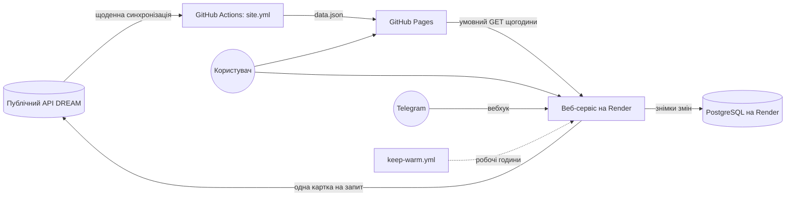

# dream-povnota

Наповненість карток проєктів відновлення в системі DREAM: які поля заповнено з тих, що доречні на стадії проєкту, і чого бракує. Розрізи за стадіями, областями, секторами й організаціями.

**Сторінка наживо: [maksym-garkusha.github.io/dream-povnota](https://maksym-garkusha.github.io/dream-povnota/)**. Дані там оновлюються щодня. Угорі сторінки кілька головних висновків з кнопкою «Показати ці картки», нижче схема областей, а перелік карток можна відфільтрувати за своєю областю і завантажити в CSV, щоб переслати громадам.

**Веб-сервіс: [dream-povnota.onrender.com](https://dream-povnota.onrender.com)**. Тут можна перевірити одну картку просто зараз, відкрити сторінку організації чи області з історією змін, вивантажити вибірку в CSV або Excel і забрати дані через API. Сервіс працює на безкоштовному тарифі й засинає без відвідувачів, тому перше відкриття після паузи може тривати близько хвилини. Докладніше в розділі [«Веб-сервіс»](#веб-сервіс).

[English version](README.en.md)

Це незалежний навчальний проєкт на відкритих даних DREAM. Він не пов'язаний з державними органами, а його числа не є офіційною статистикою.

## Навіщо

DREAM ([dream.gov.ua](https://dream.gov.ua)) це система, в якій громади, обласні адміністрації і служби відновлення ведуть проєкти відновлення та публічних інвестицій. Картку проєкту заповнює його ініціатор, і заповнюють їх по-різному: в одних є кошторис, джерела фінансування, закупівлі й фото, в інших тільки назва.

Практичне питання того, хто відповідає за наповнення системи в громаді, області чи загалом: **де саме і чого бракує в картках**. Програма забирає всі картки через публічний API, для кожної перевіряє поля, доречні на її стадії, і показує результат сторінкою. Організація може знайти себе за назвою чи ЄДРПОУ і побачити перелік своїх карток з тим, що в кожній лишилось дозаповнити.

Це не рейтинг і не пошук порушень. Офіційних правил, які поля обов'язкові на якій стадії, у відкритому доступі немає, тому вся термінологія тут нейтральна: поле «заповнено» або «не заповнено». Таблиці на сторінці типово впорядковані за назвою.

## Що показали дані

Зріз від 17 листопада 2026 року: у стрічці API 16 172 проєкти. З них 14 610 відкритих, решта 1 562 закриті (скасовані як помилкові чи дублікати або не реалізовані), їх далі не рахуємо.

**Загальна наповненість.** Середня наповненість 92,6%. У 8 949 картках із 14 610 (61%) заповнено все, що доречно на їхній стадії. Опис, місце, документи і кошторис заповнено в 99% карток, де ці поля доречні.

Більшість незаповнених полів припадає на стадію реалізації.

**Оновлення карток на стадії реалізації.** На стадії реалізації 5 660 проєктів мають джерело фінансування або закупівлю. За останній рік картку оновлювали в 1 398 з них, тобто приблизно в кожній четвертій. Решту 4 262 востаннє змінювали понад рік тому.

**Закупівля без джерела фінансування.** У 4 678 проєктах заведено закупівлю або договір. У 1 335 з них не вказано жодного джерела фінансування.

**Підтверджене фінансування без закупівлі.** З 2 107 проєктів із підтвердженим фінансуванням у 411 не заведено жодної закупівлі чи договору.

**Сектор.** Класифікації за сектором немає в 1 384 відкритих картках, тобто приблизно в кожній десятій. Такі проєкти не потрапляють у розрізи за секторами.

**Поля англійською.** Назву англійською заповнено у 208 проєктах з 14 610 (1,4%). Серед 2 963 схвалених проєктів, які ще не мають ні фінансування, ні закупівель (на сторінці вони позначені як такі, що шукають фінансування), англійську назву мають 54.

Дрібніше:

- у 60 відкритих картках замість опису стоїть службове слово: `NULL`, дефіс або крапка;
- усі 5 934 різні коди ЄДРПОУ в картках проходять перевірку контрольного розряду;
- у 17 відкритих картках у полі для ЄДРПОУ стоїть десятизначний номер, тобто податковий номер фізичної особи-підприємця замість коду юридичної особи. Проєкт такі номери не зберігає;
- у стрічці немає жодного проєкту, створеного після листопада 2025 року (за датою в коді проєкту), хоча наявні картки оновлюються й досі. Тому сторінка охоплює проєкти, заведені з вересня 2023 по листопад 2025. Чи ведуться новіші проєкти в іншому модулі, з відкритих даних не видно.

Повний звіт із розрізами: [report.md](https://maksym-garkusha.github.io/dream-povnota/report.md), він перегенеровується щодня разом зі сторінкою.

## Як рахується

### Стадії

Стадія береться з `internal.status` картки:

| Статус у API | Стадія |
|---|---|
| `pending:initiated` | Ідея |
| `pending:defined` | Визначено |
| `pending:appraised` | Оцінено |
| `active:*` | Реалізація |
| `complete*` | Завершено |
| `cancelled*`, `unsuccessful*` | Закрито: скасовані, помилкові, дублікати, не реалізовані |
| будь-що інше | Невідомий статус |

Закриті картки й картки з невідомим статусом у перевірках і розрізах не беруть участі, їх кількість показана окремо.

### Перевірки

Кожна перевірка застосовується тільки там, де поле доречне. Список живе в одному файлі, [CheckList.cs](src/DreamPovnota.Core/Checks/CheckList.cs).

| Перевірка | Доречна | Заповнено, якщо |
|---|---|---|
| Опис проєкту | усі відкриті | опис українською після зняття HTML не порожній, не службове слово і має щонайменше 30 знаків |
| Місце (код КАТОТТГ) | усі відкриті | є хоча б один код КАТОТТГ у проєкті або, якщо там порожньо, в його об'єктах |
| Сектор | усі відкриті | є класифікація `WB-ECO` (сектори Світового банку) |
| Документи або фото | усі відкриті | є хоча б один документ у проєкті, його `approaches` або пов'язаних об'єктах |
| Тривалість | з «Визначено» | `period.durationInMonth` більше нуля |
| Мета | з «Визначено» | `purposeDetails` українською не порожня і не службове слово |
| Кошторисна вартість | з «Оцінено» | сума нескасованих рядків `budgetBreakdown` більша за нуль |
| Джерело фінансування | «Реалізація» і «Завершено», якщо є нескасована закупівля чи договір | сума нескасованих джерел фінансування більша за нуль |
| Закупівля або договір | «Реалізація» і «Завершено», якщо є підтверджене (`committed`) фінансування | є хоча б один нескасований контрактний процес |
| Оновлювалась за останній рік | тільки «Реалізація», якщо є фінансування або закупівля | від останньої зміни картки до дати зрізу не більше 365 повних днів |
| Назва англійською | усі відкриті | назва `en` не порожня |
| Опис англійською | усі відкриті | опис `en` після зняття HTML не порожній і не службове слово |

Службовими словами вважаються `NULL`, `-`, `.`, `N/A`, `НЕМАЄ`, `НЕМА` без урахування регістру, а також текст, від якого після зняття тегів нічого не лишилось.

**Чому три перевірки реалізації умовні.** Статус `active:approved` означає «проєкт схвалено», а не «гроші є». Схвалений проєкт без фінансування і без закупівель це нормальний стан: він шукає фінансування, і порожні поля тут не прогалина. Тому для реалізації перевіряється узгодженість картки: закупівля є, а джерела грошей не вказано; гроші підтверджено, а закупівлі немає; у проєкті рухаються гроші чи договори, а картку рік не оновлювали. Схвалені проєкти без грошей і закупівель позначені окремо як такі, що шукають фінансування; на сторінці це фільтр.

**Наповненість картки** це частка заповнених серед доречних перевірок, без англійських. Середня наповненість розрізу це середнє цих часток по картках.

**Чому англійські поля окремо.** Англійську назву має близько 1,4% карток, тож якби англійські поля входили в наповненість, вони однаково знижували б показник майже всім і заглушили б решту відмінностей. Водночас для проєктів, що шукають гроші в іноземних донорів, вони важливі, тому показані окремою групою і окремим числом для тих, хто шукає фінансування.

**Область** визначається за кодами КАТОТТГ: дві цифри після `UA`. Якщо коди проєкту належать різним областям, це «Кілька областей», якщо кодів немає, «Не вказано». **Організація** це сторона з роллю `projectAuthor`, а якщо такої немає, перший `initiator`: саме вона веде картку. **Сектор** це перша літера коду `WB-ECO`; коди, літери яких немає в довіднику Світового банку (трапляються `O`, `OB`, `OC`), показано як «Інший код сектору», бо поле в них заповнене.

### Чого метод не бачить

- Перевіряється, чи поле заповнене, а не чи правильно. Опис на 30 знаків, який нічого не пояснює, вважається заповненим, а кошторис не звіряється з договорами.
- Невідомо, які поля DREAM вважає обов'язковими на кожній стадії. Перевірки складено з того, що логічно очікувати від картки, а не з офіційного регламенту.
- Програма бачить тільки те, що віддає публічний API. Якщо частина проєктів ведеться в іншому модулі (див. останній пункт у «Що показали дані»), її тут немає.
- Підприємців, які ведуть картки, програма свідомо не розрізняє: їхні коди й імена не зберігаються, тому на сторінці вони однією групою.

## Що допомогло б у самій системі

Ці зауваження не про людей, які ведуть картки, а про те, де система могла б їм підказати. Жодне не потребує змінювати модель даних.

1. **Нагадування про застарілу картку.** Якщо в проєкті є чинний договір, а картку не змінювали пів року, відповідальному приходить нагадування оновити стан. Це стосується найбільшої групи незаповнених полів серед тих, що входять у наповненість: 4 262 картки на стадії реалізації.
2. **Перевірка узгодженості під час збереження.** Додаєш закупівлю до проєкту без джерела фінансування, система просить його вказати. Це не заборона, а підказка в момент, коли людина вже у формі.
3. **Сектор обов'язковим полем** на першому ж кроці. Зараз його немає в кожній десятій картці.
4. **Чернетка англійської назви автоматично.** Назву проєкту можна перекласти машинно і дати ініціатору підтвердити одним натисканням. Для проєктів, що шукають фінансування, це найдешевший спосіб стати видимими для донорів.
5. **Не приймати службові слова замість тексту.** `NULL`, дефіс чи крапка в полі опису це порожнє поле, і форма може так і сказати.
6. **Нові проєкти у відкритому API.** Якщо проєкти, створені після листопада 2025 року, справді ведуться в іншому модулі, варто віддавати їх через той самий публічний інтерфейс, щоб відкриті дані не закінчувались на 2025 році.

## Запуск

Потрібен [.NET 11 SDK](https://dotnet.microsoft.com/download/dotnet/11.0). .NET 11 це STS-випуск, але за чинною політикою Microsoft його підтримка закінчується 14 листопада 2028 року, того самого дня, що й у .NET 10 LTS. Консольній програмі база не потрібна; як запустити веб-сервіс, описано в розділі [«Веб-сервіс»](#веб-сервіс).

```bash
git clone https://github.com/maksym-garkusha/dream-povnota.git
cd dream-povnota/src/DreamPovnota

dotnet run -- sync --cache ../../data         # забрати картки з API в кеш
dotnet run -- export --cache ../../data ../../site   # зібрати site/data.json
dotnet run -- report --cache ../../data ../../docs/report.md
dotnet test                                   # з кореня репозиторію
```

Сторінка це звичайний HTML-файл, але `data.json` вона читає через `fetch`, тому відкривати її треба з локального сервера: `python3 -m http.server` у теці `site`.

API державний і публічний, тому клієнт його не квапить: типово 2 потоки і пауза 100 мс перед кожним запитом; з тим, як швидко відповідає API, це близько 10 запитів на секунду замість 36 без пауз у 4 потоки. Перший `sync` качає всі картки (16 172 проєкти і 14 199 об'єктів) і займає близько години. Щоденний запуск бере з API тільки картки, змінені з минулого разу. Повний обхід потрібен лише першого разу або після зміни розбору. Інші параметри:

- `--limit 300` бере тільки перші 300 проєктів стрічки, щоб швидко перевірити, що все працює;
- `--parallel 2` скільки карток качати одночасно;
- `--as-of 2026-11-17T22:00:00Z` для `export` і `report` задає дату зрізу (типово зараз). Від неї рахується «оновлювалась за останній рік», тож з тим самим кешем і тією самою датою числа щоразу ті самі.

Якщо помилок завантаження більше 2% від стрічки, `sync` завершується з ненульовим кодом, щоб Actions не опублікували половину даних. Так само, якщо в стрічці раптом на 10% (і щонайменше на сотню) менше проєктів, ніж у кеші: тоді кеш лишається як був.

## Як влаштовано

```
src/DreamPovnota.Core/   спільне для консольної програми і веб-сервісу
  Dream/     клієнт API: стрічки з посторінковим обходом, картки, повтори
  Cards/     розбір JSON у картки проєктів та об'єктів, чищення HTML, стадії
  Store/     кеш розібраних карток у JSON Lines
  Sync/      стрічка, порівняння з кешем, дозавантаження зміненого
  Checks/    перевірки і підрахунок по картці
  Geo/       області за кодом КАТОТТГ
  Codes/     контрольний розряд ЄДРПОУ
  Stats/     зведення за стадіями, областями, секторами, організаціями
  Export/    data.json для сторінки і його читання назад
  Digest/    зріз для служб відновлення: xlsx, PDF, шрифт з ліцензією
src/DreamPovnota/        консольна програма: sync, export, report, digest
  Report/    звіт у Markdown і файли зрізу
src/DreamPovnota.Web/    веб-сервіс (ASP.NET Core, Razor Pages і мінімальний API)
  Import/    завантаження data.json з Pages, повтори після збою
  Live/      перевірка однієї картки в DREAM
  History/   знімки в PostgreSQL, міграції, ключі форм
  Lists/     фільтр карток, CSV і Excel
  Api/       /api/v1
  Feeds/     стрічки Atom
  Pages/     сторінки
site/        сторінка: один HTML-файл без збірки
docs/        звіт на зрізі, з якого взято числа в цьому README; шаблон картинки для посилань
tests/       xUnit, фікстури це справжні відповіді API з вигаданими іменами
```

**База тільки для історії.** Відкритих карток близько 15 тисяч, вони вміщуються в пам'ять, а результат консольної програми це два статичні файли. Програма читає кеш, рахує все за дві-три секунди і пише `data.json` та звіт, без бази. Веб-сервіс так само тримає поточний випуск у пам'яті, а PostgreSQL потрібна йому тільки для історії змін.

**Кеш розібраних карток, а не сирих відповідей.** Сира картка проєкту важить від 30 до 300 КБ, розібрана близько 1,5 КБ: кеш на весь зріз займає 26 МБ. Крім того, в сирих відповідях є імена людей, а в розібраних їх уже немає, тож кеш можна спокійно зберігати між запусками в Actions. Ціна рішення: коли змінюється розбір, старий кеш уже не годиться. В Actions ключ кешу залежить від коду в `Cards/`, тож після такої зміни картки завантажуються заново; локально теку кешу треба видалити самому.

**Персональні дані.** API віддає імена керівників (`parties[].persons`) і підприємців як сторони зі схемою `UA-IPN`, де код це РНОКПП, а назва це ім'я. Розбір `persons` не читає взагалі, а для підприємця зберігає тільки роль і позначку, що це фізична особа-підприємець. Так само з десятизначним номером, записаним під схемою `UA-EDR`, і зі стороною, у назві якої є «ФОП» чи «фізична особа». Схему розбір порівнює без урахування регістру, а з коду перед перевіркою прибирає пробіли й дефіси, тож `ua-ipn` чи `123 456 7899` фільтр не обминуть. На це є тести: у кеші, `data.json` і звіті немає тестових номерів і вигаданих імен із фікстур.

**Сторінка без сервера.** Щодня GitHub Actions бере кеш з попереднього запуску, дозавантажує змінені картки, збирає `data.json` (4,8 МБ, після стиснення близько 0,9 МБ) і звіт і викладає їх разом зі сторінкою на GitHub Pages. Пошук і фільтри працюють у браузері: 15 тисяч рядків фільтруються за кілька мілісекунд, а малюються тільки перші 50. Стан фільтрів зберігається в адресі, тож посиланням на вибірку можна поділитися.

**Формат `data.json`.** Щоб файл був меншим, проєкти записано масивами, а організації, області, стадії й сектори винесено в словники, на які проєкти посилаються індексами. Рядок проєкту: `[код без "DREAM-UA-", назва, організація, область, стадія, сектор, дата зміни, доречні перевірки, заповнені перевірки, шукає фінансування]`. Перевірки записано бітовими масками в порядку масиву `checks`. Назви обрізано до 160 знаків.

## Веб-сервіс

**[dream-povnota.onrender.com](https://dream-povnota.onrender.com)** додає до статичної сторінки те, що без сервера не зробити:

- перевірку однієї картки в момент запиту: код або посилання на картку DREAM, сервіс забирає її з API і рахує ті самі поля, що й для сторінки;
- сторінки організацій і областей з переліком полів, яких бракує, і посиланнями на картки без потрібного поля;
- історію змін від знімка до знімка і стрічки Atom для організації та області;
- вивантаження будь-якої вибірки в CSV і Excel;
- відкритий API з описом OpenAPI;
- Telegram-бот з тією самою перевіркою картки, якщо його увімкнено (розділ [«Telegram-бот»](#telegram-бот)).

Це той самий незалежний навчальний проєкт на відкритих даних: він не пов'язаний з державними органами, а його числа не є офіційною статистикою.

### Схема



Усю стрічку DREAM обходить тільки GitHub Actions, і доступу до бази в нього немає. Сервіс забирає опублікований `data.json` з Pages після старту і далі щогодини, з `If-None-Match`, тож незмінений файл коштує одну відповідь 304. Якщо завантажити не вдалося, сервіс пробує знову через 10 с, 30 с, 1, 2 і 5 хвилин, далі кожні 10 хвилин. Поточний стан тримається в пам'яті, тому сторінки й API не чекають на базу; у PostgreSQL іде тільки історія.

**Історія.** Кожен новий випуск `data.json` стає знімком. Нова версія картки записується тільки тоді, коли змінилось щось із організації, області, стадії, сектору, дати оновлення, заповнених полів чи пошуку фінансування. Для кожної версії зберігається діапазон знімків (тип `range`), у яких вона чинна, а тимчасовий первинний ключ PostgreSQL 18 (`WITHOUT OVERLAPS`) не дає версіям однієї картки перекриватися. Перший знімок у локальній перевірці зайняв близько 9 МБ, далі додаються тільки зміни. Історія починається з першого знімка після запуску сервісу в листопаді 2026 року: раніших змін DREAM не показує. У `data.json` є тільки відкриті картки, тому картка, що зникла з переліку, позначена як «більше не серед відкритих (закрита або вилучена з DREAM)». Коли база недоступна, сторінки показують поточний стан з поясненням, а відповіді API про історію мають код 503.

**Перевірка картки.** З того, що ввели у форму, береться тільки код проєкту; адресу запиту до DREAM сервіс складає сам, тож введений рядок адресою не стає. Посилання приймаються тільки на `dream.gov.ua`. Картки з понад 30 пов'язаними об'єктами наживо не перевіряються. Результат зберігається на 10 хвилин. У DREAM іде тільки натискання кнопки форми, а не відкриття сторінки, тож пошукові роботи запитів назовні не викликають. З однієї IP-адреси: 6 перевірок на хвилину і 30 на годину. На весь сервіс 120 на годину, і цю межу витрачають тільки ті натискання, що справді йдуть у DREAM: форма без дійсного токена, неправильний код чи результат, що вже є в кеші, її не зменшують.

### Запуск локально

Без бази, з опублікованим `data.json` з Pages:

```bash
cd src/DreamPovnota.Web
dotnet run        # http://localhost:5080, історія вимкнена
```

Щоб сервіс узяв власний файл, зібраний командою `export`, передайте шлях до нього: `DATA_URL=../../site/data.json dotnet run`.

З базою, через Docker Compose (PostgreSQL 18 і сервіс, `data.json` з Pages):

```bash
docker compose up --build   # http://localhost:10000
```

Тести історії працюють зі справжньою PostgreSQL: кожен створює собі тимчасову базу. Без змінної `TEST_DATABASE_URL` їх пропускає, у CI їх запускає сервісний контейнер `postgres:18`.

```bash
TEST_DATABASE_URL=postgres://користувач@localhost:5432/postgres dotnet test
```

### API

Тільки GET, відповіді в JSON, помилки у форматі Problem Details. Опис: [/openapi/v1.json](https://dream-povnota.onrender.com/openapi/v1.json).

```bash
# картки Чернігівської області без кошторису, перші 5
curl 'https://dream-povnota.onrender.com/api/v1/cards?region=74&missing=cost&pageSize=5'

# пошук організації за частиною назви
curl -G 'https://dream-povnota.onrender.com/api/v1/orgs' --data-urlencode 'q=Ірпінська'

# наповненість області за знімками і зміни в останньому знімку
curl 'https://dream-povnota.onrender.com/api/v1/regions/74/trend'
curl 'https://dream-povnota.onrender.com/api/v1/changes?region=74'
```

| Адреса | Що віддає |
|---|---|
| `/api/v1/meta` | випуск даних, перевірки, області, стадії, сектори |
| `/api/v1/cards` | картки з фільтром: `q`, `region`, `org`, `stage`, `sector`, `missing`, `seeks=1`, `page`, `pageSize` до 500 |
| `/api/v1/cards/{код}`, `/api/v1/cards/{код}/history` | одна картка; вона ж з версіями в історії |
| `/api/v1/cards.csv`, `/api/v1/cards.xlsx` | та сама вибірка файлом, усі рядки |
| `/api/v1/orgs`, `/api/v1/orgs/{ключ}`, `/api/v1/orgs/{ключ}/trend` | пошук організацій, розріз за організацією, наповненість за знімками |
| `/api/v1/regions`, `/api/v1/regions/{ключ}`, `/api/v1/regions/{ключ}/trend` | те саме для областей |
| `/api/v1/snapshots`, `/api/v1/changes` | знімки і зміни карток у знімку (`snapshot`, `org`, `region`) |

Код картки пишеться без `DREAM-UA-`. Ключ організації це ЄДРПОУ, а для організації без коду `n:` і назва. Ключ області це дві цифри коду КАТОТТГ (`74`), `multi` або `none`. З однієї IP-адреси: 120 запитів і 10 вивантажень файлом на хвилину.

### Excel і Power BI

CSV записано так, щоб українська Excel відкривала його подвійним клацанням: UTF-8 з BOM, крапка з комою, цілі числа, дати у вигляді `2026-11-17`. Перед клітинкою, що починається з `=`, `+`, `-` чи `@`, стоїть апостроф, щоб Excel не виконав її як формулу. Коди ЄДРПОУ з нулем на початку Excel під час відкриття CSV перетворює на числа; у файлі xlsx вони лишаються текстом.

Повний файл без фільтра сервіс готує один раз на випуск і віддає з `ETag` і `Last-Modified`: повторне завантаження незміненого файлу коштує відповідь 304, а обірване можна докачати. Вибірки з фільтром збираються на запит і кешуються до наступного випуску. Параметри `page` і `pageSize` на файл не впливають, у ньому завжди всі рядки вибірки.

**Excel.** Дані → З Інтернету, адреса `https://dream-povnota.onrender.com/api/v1/cards.csv?region=74`. У вікні Power Query виберіть роздільник «Крапка з комою» і походження файлу «65001: Юнікод (UTF-8)». Або завантажте готовий файл: `https://dream-povnota.onrender.com/export/cards.xlsx?region=74`.

**Power BI.** Отримати дані → Інтернет або запит M:

```
let
    Source = Csv.Document(
        Web.Contents(
            "https://dream-povnota.onrender.com/api/v1/cards.csv",
            [Query = [region = "74"], Timeout = #duration(0, 0, 2, 0)]),
        [Delimiter = ";", Encoding = 65001, QuoteStyle = QuoteStyle.Csv]),
    Cards = Table.PromoteHeaders(Source, [PromoteAllScalars = true])
in
    Cards
```

Базова адреса лишається сталою, а фільтр передається в `Query`: так планове оновлення в Power BI Service працює з анонімним доступом. Тайм-аут у дві хвилини покриває пробудження сервісу.

### Telegram-бот

Та сама перевірка, що й у формі `/check`, тільки в Telegram: боту надсилають код проєкту або посилання на картку, і він відповідає звичайним текстом. Бот працює тільки в приватних повідомленнях. Поки токена бота в налаштуваннях немає, адреси вебхука в сервісі теж немає.

Відповідь на `DREAM-UA-190424-A10FC799`:

```
Капітальний ремонт та модернізація харчоблоку Авдіївського ліцею в с. Авдіївка Чернігівської області.
DREAM-UA-190424-A10FC799
Стадія: Реалізація
Організація: ПОНОРНИЦЬКА СЕЛИЩНА РАДА
Заповнено 10 з 10 доречних полів.

Заповнено:
• Опис проєкту
• Місце (код КАТОТТГ)
• Сектор
• Документи або фото
• Тривалість
• Мета
• Кошторисна вартість
• Джерело фінансування
• Закупівля або договір
• Оновлювалась за останній рік

Англійською, поза підрахунком:
• є: Назва англійською
• є: Опис англійською

Усе, що доречне на цій стадії, заповнено.

Картка в DREAM: https://dream.gov.ua/ua/project/DREAM-UA-190424-A10FC799/profile
Усі картки організації: https://dream-povnota.onrender.com/org/04412567
Перевірено 18.11.2026, 08:31 за Києвом.
```

Якщо чогось бракує, з'являється список «Не заповнено», а замість рядка «Усе, що доречне на цій стадії, заповнено» стоїть «Дописати першим»: перше з незаповнених полів і навіщо воно. Англійські назва й опис ідуть окремо, бо в наповненість не входять, як і на сторінці. Посилання на організацію є, коли в сервісі є її сторінка. `/start` і `/help` пояснюють, що вміє бот, `/check <код>` теж працює, а на повідомлення без коду бот відповідає прикладом формату.

**Як працює.** Telegram надсилає кожне повідомлення POST-запитом на `/telegram/webhook` і кладе секрет у заголовок `X-Telegram-Bot-Api-Secret-Token`. Секрет є тільки в заголовку, а не в адресі, бо адреса потрапляє в журнали проксі. Сервіс порівнює заголовок із секретом вебхука за сталий час, і запит без нього чи з іншим значенням отримує 401. На справжнє повідомлення сервіс одразу відповідає 200, а картку перевіряє у фоні, з черги на 20 повідомлень, тож Telegram не чекає на DREAM і не надсилає те саме вдруге. Код із тексту дістає той самий розбір, що й у формі, а адресу запиту до DREAM сервіс складає сам. Межа на весь сервіс, 120 живих перевірок на годину, спільна для форми й бота і так само витрачається тільки на справжній запит у DREAM. Одному чату бот відповідає не частіше ніж 6 разів на хвилину і 30 на годину, а про перевищення пише раз на 10 хвилин. Цей ліміт перевіряється ще до черги, тож один чат пачкою повідомлень не займе місця інших. З однієї IP-адреси на `/telegram` приймається до 300 запитів на хвилину: оновлення приходять з кількох адрес Telegram, і звичайний ліміт сторінок зупинив би всіх користувачів разом. Відповідь іде без `parse_mode`, тому назва картки з DREAM не може стати розміткою.

**Що бот не зберігає.** Текст повідомлення і chat id живуть у пам'яті, поки готується відповідь, і нікуди не записуються: ні в базу, ні в журнал. У журнал потрапляє тільки тип збою, наприклад «Telegram відповів 403». Ліміти на чат рахуються в пам'яті, і ключ лічильника не chat id, а його відбиток HMAC з випадковим ключем, який зникає з перезапуском сервісу. Самі повідомлення, як і в будь-якого бота, бачить Telegram.

**Як увімкнути.**

1. У Telegram відкрити [BotFather](https://t.me/BotFather), команда `/newbot`, задати назву й ім'я бота. BotFather видасть токен.
2. У Render: сервіс `dream-povnota`, Environment, додати `TELEGRAM_BOT_TOKEN` з цим токеном і зберегти. Після розгортання бот запрацює.

Решту сервіс робить сам. Секрет вебхука він виводить з токена (HMAC-SHA256, токен як ключ, 64 знаки hex), тож окрема змінна не потрібна: хто знає токен, і так може переналаштувати бота. Після старту сервіс викликає `setWebhook` з адресою `{публічна адреса}/telegram/webhook`, цим секретом і `allowed_updates=["message"]`. Публічну адресу Render передає сам у `RENDER_EXTERNAL_URL`; поза Render її задає `TELEGRAM_WEBHOOK_URL`. Якщо Telegram не відповів або відповів 429 чи 5xx, сервіс пробує знову через 5 с, 30 с, 2 і 5 хвилин; на інший 4xx, наприклад неправильний токен, не повторює. У журналі буде «Вебхук Telegram зареєстровано» або причина кодом статусу, без токена. Свій секрет замість виведеного можна задати змінною `TELEGRAM_WEBHOOK_SECRET`: від 16 до 256 знаків з `A-Z`, `a-z`, `0-9`, `_` і `-`, наприклад `openssl rand -hex 32`.

Якщо зареєструвати вебхук сам сервіс не зміг, це робиться вручну. `read -rs` питає токен без показу на екрані, тож він не лишається в історії оболонки, а секрет рахується з токена так само, як у сервісі:

```bash
read -rs TOKEN    # вставити токен від BotFather, Enter
SECRET=$(printf %s 'dream-povnota/telegram-webhook' | openssl dgst -sha256 -hmac "$TOKEN" -r | cut -d' ' -f1)
curl -sS "https://api.telegram.org/bot$TOKEN/setWebhook" \
  --data-urlencode "url=https://dream-povnota.onrender.com/telegram/webhook" \
  --data-urlencode "secret_token=$SECRET" \
  --data-urlencode 'allowed_updates=["message"]'
```

Якщо в Render задано свій `TELEGRAM_WEBHOOK_SECRET`, замість другого рядка `read -rs SECRET`. Стан вебхука показує `curl -sS "https://api.telegram.org/bot$TOKEN/getWebhookInfo"` у тій самій оболонці: у `pending_update_count` видно чергу на боці Telegram, а в `last_error_message` останню помилку доставки, якщо вона була. Посилання у відповідях ведуть на `https://dream-povnota.onrender.com`; іншу адресу можна задати змінною `PUBLIC_URL`. Якщо безкоштовний екземпляр заснув, відповідь на перше повідомлення прийде приблизно за хвилину.

### Зріз для служб відновлення

Щотижневий зріз для Державного агентства відновлення та розвитку інфраструктури України і 21 обласної служби відновлення та розвитку інфраструктури. Перелік закріплено кодами ЄДРПОУ в `DigestOrganisations`: це всі організації з `data.json` від 18.11.2026, у назві яких є «агентство відновлення» або «служба відновлення». Служб у Волинській, Донецькій і Луганській областях серед тих, хто веде відкриті картки, на цю дату немає. Якщо в даних з'явиться нова служба, команда `digest` про це напише, а в перелік її додають руками.

На кожну організацію два файли:

- xlsx з аркушами «Зріз», «Картки» (стадія, що не заповнено, що дописати першим, посилання на картку в DREAM) і «Що змінилось за тиждень» (які картки оновили, які поля дозаповнили);
- PDF на одну сторінку A4: відкриті картки, у скількох з них заповнено все доречне, скільки оновлено за тиждень, до п'яти полів, які найпростіше дописати, і посилання на сторінку організації.

Тиждень це сім днів до дати випуску включно. «Оновлено за тиждень» рахується за датою оновлення картки в DREAM. Дозаповнені поля видно з історії в базі сервісу: стан карток на початок тижня порівнюється з поточним випуском, за кодами перевірок, а не за бітами. Історія ведеться з 18.11.2026, і поки їй немає тижня, у файлах так і написано. «Що дописати першим» береться з початку списку в `DigestEase`: спершу те, що вибирається зі списку чи вміщається в рядок (сектор, назва англійською, тривалість), потім тексти, файли й кошторис. Англійські поля, як і на сторінках, у «заповнено все доречне» не входять, тому для картки вони стають першими лише тоді, коли решту заповнено.

На сервісі є `/digest` (перелік у сталому порядку: агентство, далі служби за назвою області) і `/digest/{ЄДРПОУ}` з тими самими числами та кнопками xlsx і PDF. Сторінки й файли закрито від пошукових систем (`noindex`, `X-Robots-Tag`), для файлів діє той самий ліміт, що й для вивантажень, а збираються вони раз на випуск даних.

Те саме без сервісу:

```bash
dotnet run -- digest --edition ../../site/data.json --history https://dream-povnota.onrender.com ../../digest
```

`--history` вказує, звідки взяти стан карток на початок тижня (`/api/v1/digest/baseline`). Без нього, або якщо сервіс не відповів, зріз збирається без дозаповнених полів, і у файлах про це сказано. Щопонеділка те саме робить workflow `digest.yml`: файли лишаються артефактом запуску на 30 днів і на Pages не публікуються.

PDF пише PdfPig 0.1.16, xlsx MiniExcel 1.47.1, обидві бібліотеки під ліцензією Apache 2.0. У PDF вбудовано шрифт IBM Plex Sans 3.004; його ліцензія SIL Open Font License 1.1 лежить поруч зі шрифтом, у `src/DreamPovnota.Core/Digest/Fonts/OFL.txt`. Автор у властивостях файлів «Максим Гаркуша», у полях Creator і Producer назва проєкту.

### Цілісність даних

Сервіс не приймає новий `data.json`, у якому за раз змінилось набагато більше, ніж буває за день. Так підмінений чи зіпсований файл на Pages не потрапляє ні на сторінки, ні в історію, ні у зріз для служб відновлення. Новий випуск порівнюється з поточним, а після перезапуску, коли в пам'яті ще нічого немає, з останнім знімком у базі. Випуск не приймається, якщо:

- кількість відкритих карток змінилась більше ніж на 5 %;
- кількість організацій, що ведуть відкриті картки, змінилась більше ніж на 5 %;
- змінилось більше 20 % карток: нові, зниклі і ті, у яких інакше доречні чи заповнені поля. Поля порівнюються за кодами перевірок, тож нова перевірка сама по собі картки зміненими не робить.

Тоді поточним лишається попередній випуск. У `/health/ready` в полі `lastError` з'являється тип причини (`EditionGuard: open-cards`, `EditionGuard: organisations` або `EditionGuard: changed-cards`), а числа пишуться в журнал з рівнем Warning. Причина тримається, поки не прийнято наступний випуск.

Звідки пороги. У `data.json` від 18.11.2026 відкритих карток 14 610, організацій 2 834. За останні 12 місяців найбільше карток за день, 116 (0,8 %), востаннє оновили 25.03.2026, а в будь-який інший день не більше 33 (0,2 %). Дата оновлення в `data.json` остання, тож це нижня межа. За датою в коді проєкту найбільше нових карток за день з'явилось 11.09.2023: 355, або 2,4 % від нинішніх відкритих; за тиждень 19–25.08.2024 їх було 1 051 (7,2 %). На сервісі між сусідніми знімками 18.11.2026 відкритих карток лишалось 14 610, а змінювалось від 0 до 2 карток. Тобто 5 % і 20 % з запасом покривають звичайний день і тиждень без публікації. Масові оновлення в DREAM теж бували: 23.01.2025 востаннє оновили 3 746 карток, 25,6 % нинішніх відкритих. Якщо таке оновлення змінить поля, запобіжник його зупинить, і прийняти випуск доведеться вручну.

Справжній стрибок приймають так: перевіряють, що файл зібрав `site.yml` з коду цього репозиторію, і вписують його SHA-256 у змінну `ImportGuard__AcceptSha256` на Render. Це діє лише на файл з таким хешем. Пороги задаються змінними `ImportGuard__OpenCardsPercent`, `ImportGuard__OrganisationsPercent` і `ImportGuard__ChangedCardsPercent`.

Чого запобіжник не вміє. Якщо після перезапуску бази немає або вона не відповіла, порівнювати нема з чим, і перший випуск приймається з попередженням у журналі. Якщо ж випуск відкинуто одразу після перезапуску, попереднього в пам'яті немає, і сторінки відповідають 503, поки на Pages не з'явиться добрий файл: краще не показати нічого, ніж показати підмінене.

### Розгортання і обмеження безкоштовного тарифу

`render.yaml` це Blueprint Render: безкоштовний веб-сервіс з Docker-образу і безкоштовна PostgreSQL 18 у Франкфурті. `DATABASE_URL` Render підставляє з керованої бази сам, тож у репозиторії, CI і налаштуваннях Actions секретів немає. Крім неї, сервіс читає `DATA_URL`, адресу `data.json`, а для бота `TELEGRAM_BOT_TOKEN`, який вписується вручну в налаштуваннях Render, і за потреби `TELEGRAM_WEBHOOK_SECRET` та `TELEGRAM_WEBHOOK_URL`. Нову версію зараз розгортають вручну з панелі Render або через його API: застосунок Render ще не підключено до репозиторію, тому `autoDeployTrigger: commit` у Blueprint почне працювати після підключення. Docker-образ збирається в CI на кожен пуш, тож зламаний Dockerfile видно ще до розгортання.

Обмеження безкоштовного тарифу за документацією Render станом на листопад 2026 року:

- 0,1 CPU і 512 МБ пам'яті; сервіс засинає після 15 хвилин без запитів і прокидається близько хвилини;
- 750 годин роботи на місяць на весь обліковий запис і 5 ГБ вихідного трафіку, тому відповіді стискаються й кешуються, а запити до DREAM обмежено;
- безкоштовна база має 1 ГБ диска і перестає працювати через 30 днів після створення, а ще через 14 днів її видаляють. Сайт після цього працює далі, бо поточний стан береться з Pages, але історія пропаде, якщо до того не перевести базу на платний тариф або на іншу PostgreSQL. Переїзд це заміна `DATABASE_URL`, у коді нічого міняти не треба;
- `keep-warm.yml` у будні з 07:00 до 19:00 за Києвом (улітку на годину пізніше) раз на 10 хвилин відкриває `/health/live`, щоб сервіс не засинав. Це близько 265 годин на місяць.

Ключі, якими підписано токени форми перевірки, сервіс зберігає в тій самій базі без шифрування: вони захищають тільки від підробленої форми і персональних даних не стосуються. Тому попередження Data Protection про те, що шифрувальник не налаштовано, у журналі очікуване.

`/health/live` відповідає `ok` і не звертається ні до бази, ні до DREAM. `/health/ready` показує, чи завантажено випуск, коли востаннє перевіряли Pages і тип останнього збою (без тексту помилки), стан бази і дату останнього знімка. Базу він питає не частіше ніж раз на 10 секунд.

## Чого тут немає

- Зміст полів не перевіряється, тільки їх наявність. Чи відповідає кошторис договорам, чи правдивий опис, програма не знає.
- Статична сторінка показує тільки останній зріз. Історія змін є у веб-сервісі, і тільки від його першого знімка.
- Дані Prozorro не підтягуються: закупівля вважається наявною, якщо вона заведена в картці DREAM.
- Організації не впорядковуються за наповненістю і не порівнюються між собою. Це свідомо: інструмент для того, щоб знайти, що дозаповнити, а не для рейтингу.

## Дані та ліцензія

Дані: публічний API системи DREAM (`public-api.dream.gov.ua`), опис API: [open-contracting.github.io/dream-api-docs](https://open-contracting.github.io/dream-api-docs/). На порталі DREAM для даних указано ліцензію Creative Commons Attribution 4.0 International. У `tests/DreamPovnota.Tests/Fixtures` лежать кілька справжніх відповідей API, у яких імена людей і дані підприємця замінено вигаданими, а довгі масиви обрізано.

Код: MIT.
